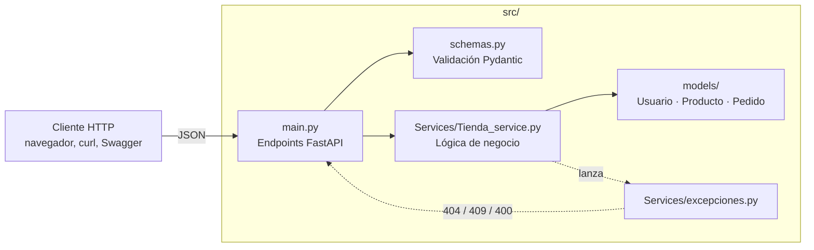

# 🛒 Tienda Online — API REST

**Autor:** Óscar Luaces ([@oscarluaces](https://github.com/oscarluaces))
**Asignatura:** Arquitectura del Software — Universidad Intercontinental de la Empresa (UIE)


## 📖 Descripción

API REST en **FastAPI** para gestionar una tienda online: usuarios (clientes y
administradores), un catálogo de productos de distintas categorías y pedidos con control de
stock.

Es la evolución de la aplicación de consola de la Práctica 1. El modelo de dominio y la
lógica de negocio (`TiendaService`) se reutilizan, y se añade una capa de exposición HTTP.
En la Práctica 3.2 la API se **conteneriza con Docker** y la imagen se publica en Docker Hub.

> ℹ️ Los datos se guardan **en memoria**: se pierden al reiniciar la API o el contenedor.

## 🧱 Arquitectura



- **`models/`**: dominio (`Usuario` → `Cliente`/`Administrador`, `Producto` →
  `ProductoElectronico`/`ProductoRopa`, `Pedido`).
- **`Services/`**: `TiendaService` contiene la lógica de negocio y lanza excepciones propias.
  No depende de FastAPI.
- **`schemas.py`**: valida las peticiones y da forma a las respuestas.
- **`main.py`**: define los endpoints y traduce las excepciones a códigos HTTP
  (`RecursoNoEncontrado` → 404, `Conflicto` → 409, `OperacionNoValida` → 400).

## 🗂️ Estructura del proyecto

```
tienda-online/
├── src/                       # Código fuente de la API
│   ├── main.py                # App FastAPI y endpoints
│   ├── schemas.py             # Esquemas Pydantic (peticiones y respuestas)
│   ├── demo.py                # Demo por consola de TiendaService (sin API)
│   ├── models/
│   │   ├── Usuario.py
│   │   ├── Producto.py
│   │   └── Pedido.py
│   └── Services/
│       ├── Tienda_service.py
│       └── excepciones.py
├── tests/
│   └── test_api.py            # 13 tests de la API (pytest + TestClient)
├── Dockerfile
├── .dockerignore
├── requirements.txt           # Dependencias de la API (versiones fijadas)
├── requirements-dev.txt       # + dependencias para ejecutar los tests
├── pytest.ini
├── .gitignore
└── README.md
```

## 🔌 Endpoints

| Método | Ruta | Descripción | Respuestas |
|---|---|---|---|
| `POST` | `/usuarios` | Registra un cliente o un administrador | 201, 409, 422 |
| `GET` | `/usuarios` | Lista los usuarios | 200 |
| `GET` | `/usuarios/{usuario_id}` | Obtiene un usuario | 200, 404 |
| `POST` | `/productos` | Crea un producto (`generico`, `electronico` o `ropa`) | 201, 422 |
| `GET` | `/productos` | Lista los productos | 200 |
| `GET` | `/productos/{producto_id}` | Obtiene un producto | 200, 404 |
| `GET` | `/productos/{producto_id}/stock` | Consulta el stock de un producto | 200, 404 |
| `DELETE` | `/productos/{producto_id}` | Elimina un producto | 204, 404 |
| `POST` | `/pedidos` | Crea un pedido y descuenta el stock | 201, 400, 404, 422 |
| `GET` | `/usuarios/{cliente_id}/pedidos` | Histórico de pedidos de un cliente | 200, 400, 404 |

La documentación interactiva (Swagger UI) está en **`/docs`**, y la especificación OpenAPI en
`/openapi.json`.

## 🐳 Ejecución con Docker

**Requisitos:** [Docker Desktop](https://www.docker.com/products/docker-desktop/) (o Docker
Engine) instalado y en marcha.

### Opción A: descargar la imagen publicada

```bash
docker pull oscarluaces/tienda-online:2.0.0
docker run --rm -p 8000:8000 oscarluaces/tienda-online:2.0.0
```

### Opción B: construir la imagen desde el código

Desde la raíz del repositorio:

```bash
docker build -t tienda-online:2.0.0 .
```

- `-t tienda-online:2.0.0` pone nombre y versión a la imagen (la misma versión que la API).
- El `.` indica que el contexto de construcción es la carpeta actual. El `.dockerignore`
  deja fuera `.git`, `tests/`, entornos virtuales, cachés, etc.

Para comprobar que la imagen se ha creado:

```bash
docker images tienda-online
```

### Ejecutar el contenedor

```bash
# En primer plano (Ctrl+C para pararlo); --rm borra el contenedor al terminar
docker run --rm -p 8000:8000 tienda-online:2.0.0

# En segundo plano y con nombre
docker run -d --name tienda-api -p 8000:8000 tienda-online:2.0.0
docker logs -f tienda-api        # ver los logs
docker stop tienda-api           # pararlo
docker rm tienda-api             # borrarlo
```

`-p 8000:8000` publica el puerto 8000 del contenedor en el 8000 de tu equipo. Con el
contenedor en marcha, abre **http://localhost:8000/docs**.

Al arrancar, los logs deben mostrar:

```
INFO:     Started server process [1]
INFO:     Waiting for application startup.
INFO:     Application startup complete.
INFO:     Uvicorn running on http://0.0.0.0:8000 (Press CTRL+C to quit)
```

### Variables de entorno

La imagen configura uvicorn con variables de entorno, que se pueden cambiar con `-e`:

| Variable | Valor por defecto | Descripción |
|---|---|---|
| `UVICORN_HOST` | `0.0.0.0` | Interfaz en la que escucha. Debe ser `0.0.0.0` para que la API sea accesible desde fuera del contenedor |
| `UVICORN_PORT` | `8000` | Puerto interno de la API |
| `UVICORN_LOG_LEVEL` | `info` | Nivel de log: `critical`, `error`, `warning`, `info`, `debug`, `trace` |
| `PYTHONUNBUFFERED` | `1` | Los logs aparecen al momento en `docker logs` |
| `PYTHONDONTWRITEBYTECODE` | `1` | No se generan ficheros `.pyc` en el contenedor |

Ejemplo: la API en el puerto 9000 y con menos logs:

```bash
docker run --rm -e UVICORN_PORT=9000 -e UVICORN_LOG_LEVEL=warning -p 9000:9000 tienda-online:2.0.0
```

La API no usa secretos ni credenciales, así que no hace falta ningún fichero `.env`.

### Cómo está construida la imagen

| Paso | Instrucción | Motivo |
|---|---|---|
| Imagen base | `FROM python:3.12-slim` | Variante ligera de Python, con una imagen final más pequeña |
| Dependencias | `COPY requirements.txt` + `pip install --no-cache-dir` | Se copian antes que el código para aprovechar la caché de capas; `--no-cache-dir` no guarda la caché de pip en la imagen |
| Código | `COPY src/ ./src/` | Solo se copia el código fuente |
| Permisos | `useradd` + `chown` + `USER appuser` | La API se ejecuta con un usuario sin privilegios, no como `root` |
| Puerto | `EXPOSE 8000` | Documenta el puerto en el que escucha la API |
| Inicio | `CMD ["uvicorn", "main:app", "--app-dir", "src"]` | Arranca uvicorn; host y puerto se leen de las variables de entorno |

## 🧪 Pruebas

### 1. Desde el navegador (Swagger UI)

Con el contenedor en marcha, abre http://localhost:8000/docs. Prueba en este orden:

1. `POST /usuarios`: crea un cliente. Copia el `id` que devuelve.
2. `POST /productos`: crea un producto electrónico con `stock: 10`. Copia su `id`.
3. `POST /pedidos`: crea un pedido con el `id` del cliente y 1 unidad del producto. Devuelve
   **201** con el `total` y las líneas del pedido.
4. `GET /productos/{producto_id}/stock`: el stock ha bajado de **10 a 9**.
5. `GET /usuarios/{cliente_id}/pedidos`: aparece el pedido.

### 2. Desde la terminal (PowerShell)

```powershell
$api = "http://localhost:8000"

# Crear un cliente y un producto
$cliente = Invoke-RestMethod -Method Post -Uri "$api/usuarios" -ContentType "application/json" `
  -Body '{"nombre":"Maria Lopez","email":"maria@email.com","tipo":"cliente","direccion":"Calle Mayor 1"}'
$portatil = Invoke-RestMethod -Method Post -Uri "$api/productos" -ContentType "application/json" `
  -Body '{"tipo":"electronico","nombre":"Portatil Gaming","precio":1200,"stock":10,"meses_garantia":36}'

# Hacer un pedido
$pedido = @{ cliente_id = $cliente.id; items = @(@{ producto_id = $portatil.id; cantidad = 1 }) } | ConvertTo-Json -Depth 3
Invoke-RestMethod -Method Post -Uri "$api/pedidos" -ContentType "application/json" -Body $pedido

# Comprobar el stock y el histórico
Invoke-RestMethod "$api/productos/$($portatil.id)/stock"
Invoke-RestMethod "$api/usuarios/$($cliente.id)/pedidos"
```

Resultado esperado:

- El pedido devuelve `total : 1200` y una línea con `cantidad : 1`.
- El stock devuelve `stock : 9` y `disponible : True`.
- El histórico devuelve 1 pedido.

Casos de error que se pueden comprobar:

| Prueba | Respuesta esperada |
|---|---|
| Registrar otra vez el mismo email | `409` — Ya existe un usuario con ese email |
| Pedir más unidades de las que hay en stock | `400` — Stock insuficiente |
| Hacer un pedido con el `id` de un administrador | `400` — Solo los clientes pueden realizar pedidos |
| Consultar un producto que no existe | `404` — Producto no encontrado |
| Crear un electrónico sin `meses_garantia` | `422` — Error de validación |

### 3. Tests automáticos (en local, sin Docker)

```bash
python -m venv .venv
.venv\Scripts\activate            # Windows  (Linux/macOS: source .venv/bin/activate)
pip install -r requirements-dev.txt
pytest -v
```

Resultado esperado: **13 passed**.

## ▶️ Ejecución local (sin Docker)

Con el entorno virtual anterior activado, desde la raíz del repositorio:

```bash
uvicorn main:app --app-dir src --reload    # API en http://127.0.0.1:8000/docs
python src/demo.py                         # demo por consola de TiendaService
```

## 📦 Publicar la imagen en Docker Hub

```bash
docker login
docker tag tienda-online:2.0.0 oscarluaces/tienda-online:2.0.0
docker tag tienda-online:2.0.0 oscarluaces/tienda-online:latest
docker push oscarluaces/tienda-online:2.0.0
docker push oscarluaces/tienda-online:latest
```

El flujo completo es **build → run → test → push**: solo se publica una versión después de
comprobar que funciona en local.

## 🌿 Flujo de trabajo con Git

- `main`: rama principal y estable, protegida. Los cambios entran solo mediante Pull Request.
- `feature/*`: una rama por funcionalidad (por ejemplo `feature/docker`).

## 🛣️ Hoja de ruta

- [x] Práctica 1: modelo de dominio y `TiendaService` (POO, consola)
- [x] Práctica 2: API REST con FastAPI y tests
- [x] Práctica 3.1: control de versiones con Git y GitHub
- [x] Práctica 3.2: contenerización con Docker y publicación en Docker Hub
